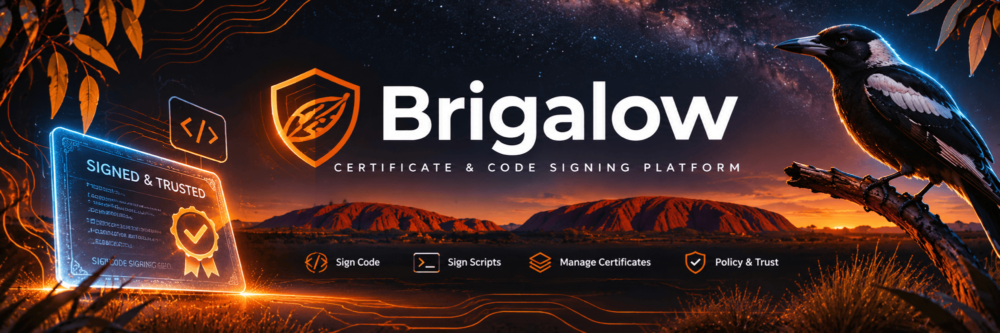
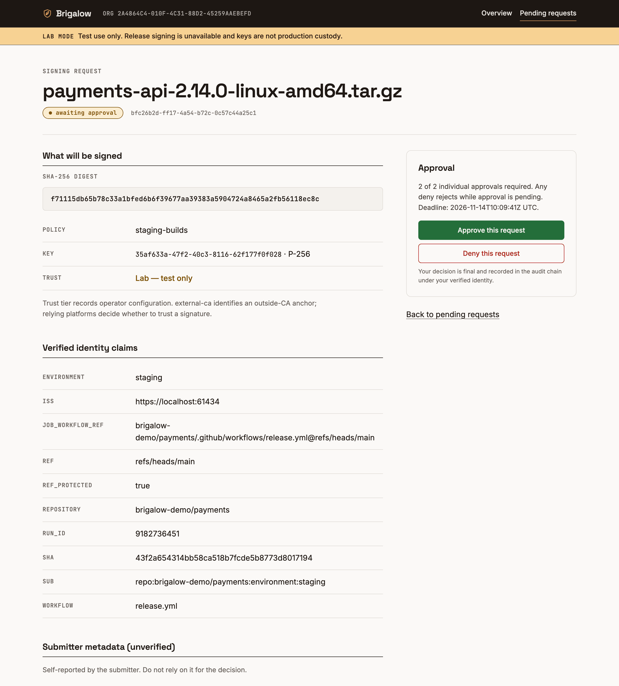
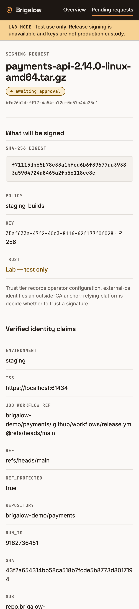
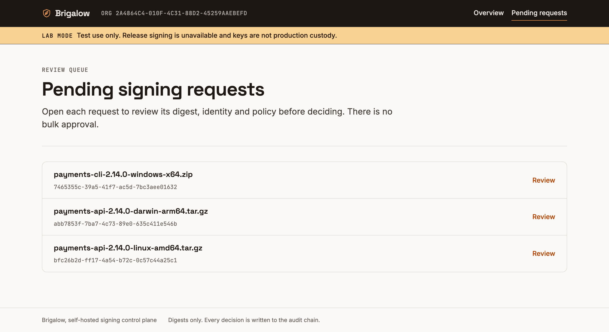
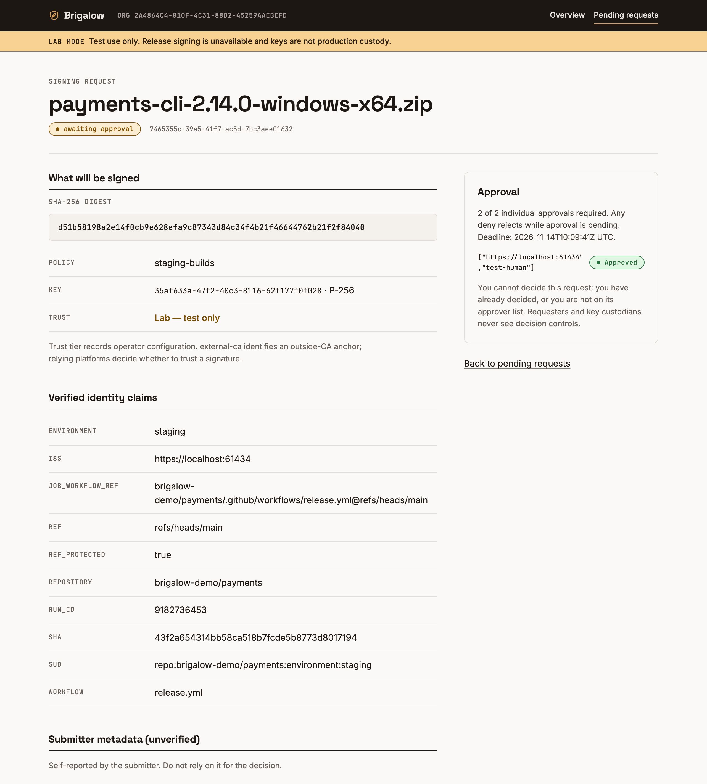
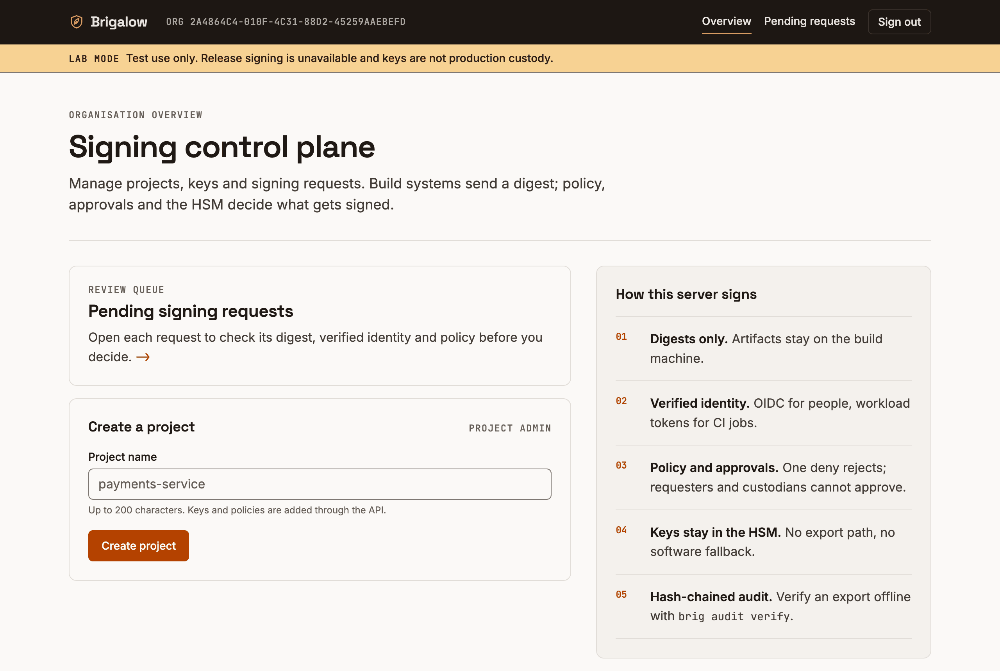

<p align="center">
  
</p>

# Brigalow

Open-source, self-hosted signing control plane. Build systems send a digest; Brigalow checks who is asking and whether policy allows it, has a key in an HSM sign it, and keeps a tamper-evident record.

> **Status, 13-11-2026: development software.** Phases 0–8 are implemented and pass the full local acceptance harness (Postgres, SoftHSM2, test IdP, TSA, OpenSSL and native tools) plus hosted CI. Nothing has been deployed to production, enrolled with a real CA or signed through a real Azure account. Treat it as a reviewed prototype, not a qualified service.

## Where it stands

| Area | State |
| --- | --- |
| Identity, RBAC and tenant isolation (OIDC, workload tokens, Postgres RLS) | Implemented and acceptance tested |
| HSM key custody (PKCS#11), digest signing, CMS and RFC 3161 timestamps | Implemented; qualified against SoftHSM2 only, no vendor HSM yet |
| Approvals, release windows, pre-sign gates, DSSE provenance | Implemented and acceptance tested |
| Native tools (osslsigncode, jsign, cosign, GPG) and GitHub Actions | Implemented through the Brigalow PKCS#11 module |
| Optional private CA, rate limits, signed audit checkpoints, backup and recovery drills | Implemented and acceptance tested |
| Azure Artifact Signing backend and Bicep reference deployment | Tested against a local mock and offline Bicep checks; [first real deployment runbook](docs/runbooks/azure-first-deployment.md) not yet exercised |
| Operator release signing (v2 manifest, strict verifier) | Implemented with generated keys; no production HSM qualified, nothing published |
| GitLab workload identity | Test-purpose policies only, pending real GitLab token shapes |
| Stranded-request resolution and fencing | Design under review ([plan 006](plans/006-fencing-and-resolution.md)); read-only inspection only today |
| High availability | Shared login state done; one replica enforced until fencing lands |

The [plans index](plans/README.md) records what each slice delivered, what is blocked and why. [ROADMAP.md](ROADMAP.md) has the phase plan.

## The approval UI

Server-rendered with askama and a vendored htmx, no Node build, no inline script or style, self-hosted fonts under a same-origin CSP. Screenshots come from a disposable lab server with generated keys and a test IdP.

<table>
<tr>
<td width="62%"></td>
<td width="38%"></td>
</tr>
<tr>
<td colspan="2"><sub>An approver sees exactly what will be signed: the digest, the bound key and its trust tier, and the identity claims the IdP verified. Unverified submitter metadata is labelled as such. Requesters and key custodians never get the decision buttons.</sub></td>
</tr>
</table>

| Review queue | After one of two approvals |
| --- | --- |
|  |  |



## Quick start

### Local evaluation

Needs Rust, OpenSSL, Python 3 and Docker Compose. Nothing leaves your machine.

```bash
cargo test --workspace
# Disposable Postgres, SoftHSM2, test IdP and TSA; generated credentials; cleans up after itself.
python3 scripts/e2e.py --context orbstack   # or your local Docker context
```

For a hands-on lab server (`mode = "lab"`, software keys, test purpose only) see [local development](docs/development.md).

### Azure with Artifact Signing

The Bicep in [deploy/azure](deploy/azure/README.md) runs one Brigalow VM that signs through an Azure Artifact Signing certificate profile, with private PostgreSQL and Key Vault. It has been validated offline only.

You need:

- an Azure subscription and resource group, with the `Microsoft.CodeSigning` resource provider registered;
- a completed Artifact Signing identity validation (portal only, needs the Identity Verifier role), with its ID. Validations are subscription-scoped and shared across accounts. Creating the Artifact Signing account to start one begins billing;
- an OIDC provider for staff, plus your CI's OIDC issuer;
- a reviewed Brigalow production image pinned by digest, pullable by the VM without a registry login.

```bash
cp deploy/azure/main.bicepparam.example deploy/azure/main.bicepparam   # fill placeholders; secrets via Key Vault references
az deployment group create --resource-group <rg> \
  --template-file deploy/azure/main.bicep --parameters deploy/azure/main.bicepparam
```

Follow the [first-deployment runbook](docs/runbooks/azure-first-deployment.md) for the whole sequence, including clean-up. The first boot is expected to show a failed server and no `/healthz`: the server cannot start until bootstrap creates its database login. Then, as separate owner steps from a temporary admin VM in the template's `vm` subnet (the only subnet the database admits): `brigalow-admin migrate`, create the restricted runtime login, `brigalow-admin org-create --org <uuid> --name <name>`. Sign in, create a project, pin the profile's reviewed root and EKU, redeploy with the key binding, and register it as a custodian (`{"remote_key":"<uuid>","algorithm":"rsa3072","purpose":"release","offline":false}`). Create a policy, then sign from CI:

```bash
# BRIGALOW_TOKEN holds the CI job's workload OIDC token (audience brigalow:<org>), set by the CI
# secret mechanism, never on the command line.
brig sign --server https://signing.example.org \
  --org <org> --project <project> --policy release --format cms --output app.cms app.bin
```

[deploy/azure/README.md](deploy/azure/README.md) has every step, including timestamps: Microsoft's TSA is HTTP only, so set the optional `tsaUrl` parameters for an HTTPS TSA you trust, or leave them unset and disable timestamps knowingly. The certificates last 72 hours.

## Why

Signing keys still end up on build agents and laptops. Commercial signing platforms fix that, but the only open-source signing server with a long history (SignServer Community Edition) dropped HSM support in 7.7.1 and is labelled non-production. Brigalow aims to be a production-intended, HSM-first option you can run yourself, including air-gapped.

## Capabilities

- Keep private keys in an HSM through PKCS#11, or delegate to an Azure Artifact Signing certificate profile, with every returned certificate chain and signature validated before use. Software keys are lab-only; cloud KMS backends remain future work. No export.
- Accept digests only; artifacts stay on the build machine.
- Authenticate humans with OIDC and CI jobs with OIDC workload tokens, matched against rules (repo, branch, workflow, environment).
- Enforce signing policies with a test or release purpose, async k-of-n approvals where one deny rejects, release windows with signature caps, and fail-closed pre-sign gates.
- Produce raw signatures and detached CMS with RFC 3161 timestamps; a PKCS#11 module so existing tools (osslsigncode, jsign, cosign, GPG) work unchanged.
- Record every step in a hash-chained audit log you can verify offline.

## What it won't do

Brigalow's optional private CA supports self-hosted trust. Brigalow cannot act as a public CA or make a signature publicly trusted. Public trust (Windows SmartScreen, macOS Gatekeeper and similar) needs a certificate from a public CA after identity validation, usually with a fee and certified key hardware. Brigalow can put policy, approvals and audit in front of such a key, but the trust comes from the CA. See [docs/product/scope.md](docs/product/scope.md).

## Docs

| Doc | What's in it |
| --- | --- |
| [docs/research/](docs/research/README.md) | Research on ten commercial signing products, with an evidence register and comparison |
| [docs/product/scope.md](docs/product/scope.md) | Who it's for, trust tiers, scope and non-goals |
| [docs/architecture.md](docs/architecture.md) | Components, request lifecycle, audit chain, identity, tenancy |
| [docs/threat-model.md](docs/threat-model.md) | Assets, boundaries, threats, controls |
| [docs/acceptance-tests.md](docs/acceptance-tests.md) | Executable acceptance tests per phase |
| [ROADMAP.md](ROADMAP.md) | Phased plan |
| [plans/](plans/README.md) | Direction plans, implementation outcomes and recorded decisions |
| [docs/operations.md](docs/operations.md) | Credential budgets, checkpoints, recovery, release workflow |
| [docs/runbooks/](docs/runbooks/azure-first-deployment.md) | First real Azure deployment, step by step |
| [docs/decisions/](docs/decisions) | Licence, stack, trust tier decisions |

## Build

Requires stable Rust (CI uses the current stable release), OpenSSL, Python 3 and Docker Compose for integration tests.

```bash
cargo fmt --all -- --check
cargo clippy --workspace --all-targets --all-features -- -D warnings
cargo test --workspace
# Use your explicitly selected local Docker context (e.g. orbstack on macOS).
scripts/e2e.sh --context orbstack
```

The end-to-end harness creates disposable Postgres and SoftHSM2 containers, generates passwords and TLS keys at runtime, runs acceptance tests, starts the server, checks health and secret redaction, then removes its containers, image, network and temporary files. It does not enrol with a CA or contact a signing service. See [local development](docs/development.md) for configuration and database setup.

Verify a single-organisation audit export offline:

```bash
cargo run -p brig -- audit verify export.jsonl
```

This checks chain integrity. Add `--checkpoint checkpoint.json --public-key trusted.der` to authenticate an exact exported prefix against an independently pinned audit key. Retain the latest signed head outside the signing host to detect rollback. See [operations](docs/operations.md).

Additional guides: [private CA](docs/private-ca.md), [native integrations](docs/integrations/pkcs11.md), [CSC mock](docs/integrations/csc-mock.md), [Azure Artifact Signing](docs/integrations/azure-artifact-signing.md), [Azure deployment](deploy/azure/README.md), [HSM CA attestation](docs/integrations/hsm-ca-attestation.md), [Azure evaluation](docs/integrations/azure-evaluation.md).

## Licence

Apache-2.0. See [LICENSE](LICENSE) and [docs/decisions/0001-licence.md](docs/decisions/0001-licence.md).

Product names mentioned in the research belong to their owners. Brigalow contains no code, UI or text from those products.
